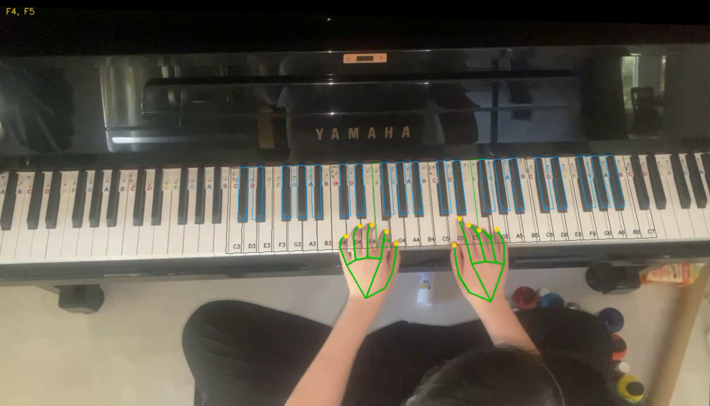

# Piano Analyzer

Transcribe recorded piano performances using audio and visual evidence. Transkun proposes notes from audio. MediaPipe fingertip observations provide supporting evidence and mark uncertain notes for review.

[](https://www.python.org/downloads/)
[](https://opencv.org/)
[](https://ai.google.dev/edge/mediapipe/solutions/vision/gesture_recognizer)
[](https://pytorch.org/)
[](LICENSE)

[](#quick-start)
[](docs/architecture.md)
[](docs/evaluation.md)
[](docs/reports/Piano_Analyzer_Public_Report.pdf)

<a href="docs/examples.md"></a>

[Example screenshots](docs/examples.md)

## Quick start

Follow the [setup guide](docs/setup.md) to install Python 3.10, both environments, and the models. Use your own constant-frame-rate piano recording:

```powershell
.\.venv\Scripts\python.exe -m piano_analyzer --input "videos/performance.mp4" --calibration "calibration/performance/keyboard.json" --output "results/performance" --calibrate --save-evidence --show
```

Calibrate once for each camera position. Later runs can omit `--calibrate`.

## Outputs

`performance.mid`, `annotated.mp4`, and optional `evidence.csv`. Notes without sufficient visual support are retained from audio and flagged for review.

## Verification

```powershell
.\.venv\Scripts\python.exe -B -m unittest discover -s tests -v
```

21 unit tests. The optional [full pipeline check](docs/setup.md#full-pipeline-check) runs both models on generated video and silence without personal media.

## Limitations

Manual calibration covers C3-C7. Camera movement, occlusion, and audio-model errors can affect results. Note endings and velocity are audio estimates. Physical key releases and strike strength are not measured.

The [October 2026 report](docs/reports/Piano_Analyzer_Public_Report.pdf) describes the original implementation. Current methodology and historical measurements are documented in [evaluation](docs/evaluation.md).

## License

[MIT](LICENSE). See [third-party notices](docs/THIRD_PARTY_NOTICES.md) for source acknowledgements, libraries, and model references.
