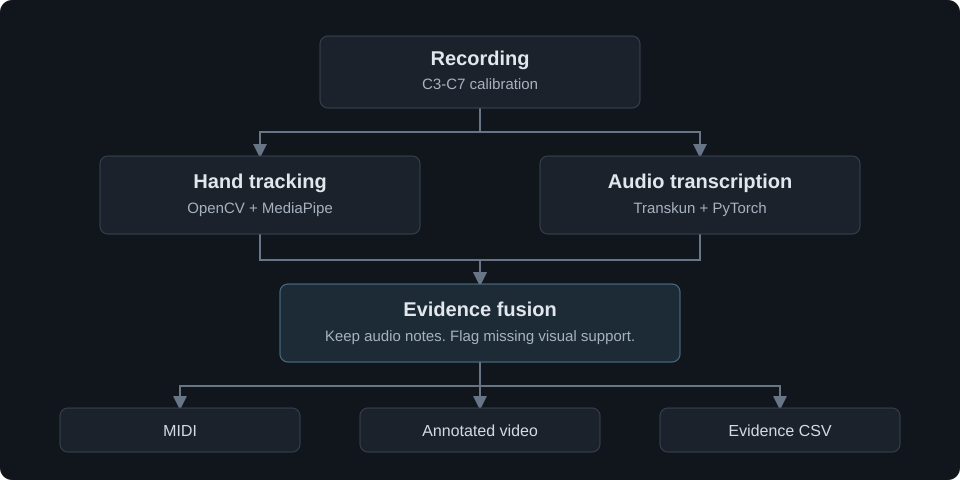

# Architecture



## Input and calibration

The CLI reads a recorded video containing piano audio. A saved or manually selected four-corner keyboard calibration and five C-key anchors establish a perspective mapping over C3-C7. The range includes 29 white and 20 black keys.

OpenCV decodes the video. `imageio-ffmpeg` supplies the FFmpeg executable used to extract stereo PCM16 WAV audio at 44.1 kHz.

## Independent analysis

`analyze_streams` starts two tasks in a `ThreadPoolExecutor` unless `--sequential` is supplied:

1. **Video:** MediaPipe GestureRecognizer runs in VIDEO mode for up to two hands. Landmarks 4, 8, 12, 16, and 20 are mapped into keyboard coordinates. The program stores fingertip candidates and landmark results rather than full frames.
2. **Audio:** A subprocess runs `piano_transkun.py` inside `.venv-transkun`. It loads Transkun's packaged V2 configuration and checkpoint, transcribes audio, writes temporary MIDI, and returns in-range notes with estimated onset, ending, and velocity.

The models do not share Python environments or mutable model objects. Exceptions propagate to the caller. Both results are gathered before fusion. This concurrency does not establish a measured speedup; timing needs to be compared on the same workload and hardware.

## Visual support and fusion

For each audio note, visual observations within 0.12 seconds of the onset are considered. Fingertips contribute support for the key directly underneath them, with weaker support for nearby keys. At most one fingertip contributes per frame. Support from the two strongest distinct frames is averaged; a score of at least 0.6 marks the note `audio_and_video`.

Notes below that threshold remain `audio_only` and are marked `needs_review`. Missing tracking does not veto an audible note. Visual support is a heuristic, not a calibrated confidence probability. It does not measure key depression or independently prove that a note was played.

`piano_expression.py` records visual observations near the audio-estimated ending. It does not extend or shorten that ending, and it does not change velocity.

## Output

- `piano_notes.py` writes all fused note events into a piano MIDI track.
- `piano_fusion.py` optionally writes CSV evidence, including provenance, support, visibility, hand/finger assignment, and review state.
- `piano_video.py` decodes the video again to draw key outlines, landmarks, and note labels. Question marks identify notes flagged for review.
- `piano_sound.py` combines the annotated video with audio from the input recording.

Intermediate audio, model-output MIDI, and silent video are held in a temporary directory. Final outputs are saved in the requested results directory. Overall printed runtime includes analysis and output generation.

## Evaluation boundary

The project evaluator measures exact pitch and onset agreement with one-to-one note matching. It does not score physical releases, velocity, fingertip localization, or finger assignment. The current architecture differs from the system evaluated in the [original report](reports/Piano_Analyzer_Public_Report.pdf).

## Module reference

Source modules are grouped under `src/piano_analyzer/`.

```text
piano_handtracking.py     CLI and parallel analysis coordination
piano_calibration.py      Manual keyboard calibration
piano_keyboard.py         Perspective transform and key geometry
piano_press.py            Fingertip observations and support scoring
piano_transkun.py         Isolated audio-model subprocess
piano_fusion.py           Audio/video evidence and CSV output
piano_expression.py       Visual observations near note endings
piano_notes.py            MIDI export
piano_video.py            Overlay rendering
piano_sound.py            FFmpeg audio extraction and remuxing
piano_evaluate.py         One-to-one pitch/onset evaluation
tests/                   Unit tests
scripts/                 Model download and environment checks
docs/                    Setup, architecture, evaluation, and original report
examples/                Synthetic calibration example
```
