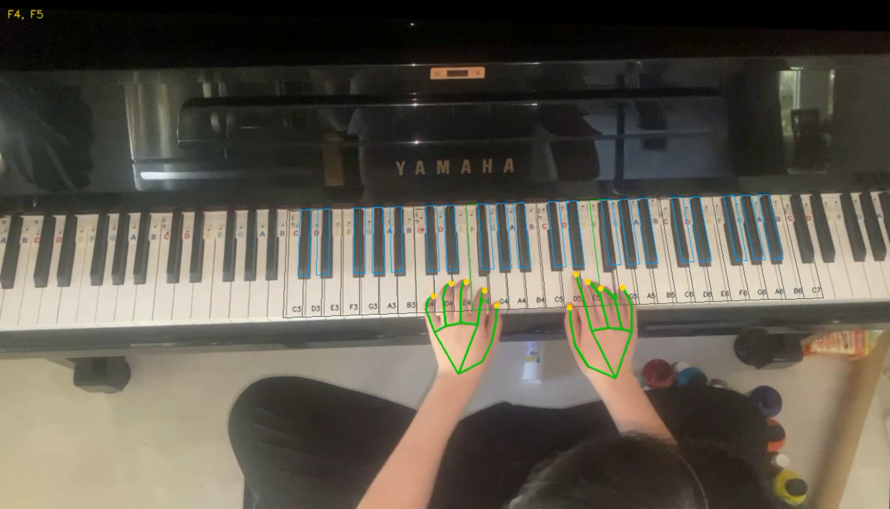
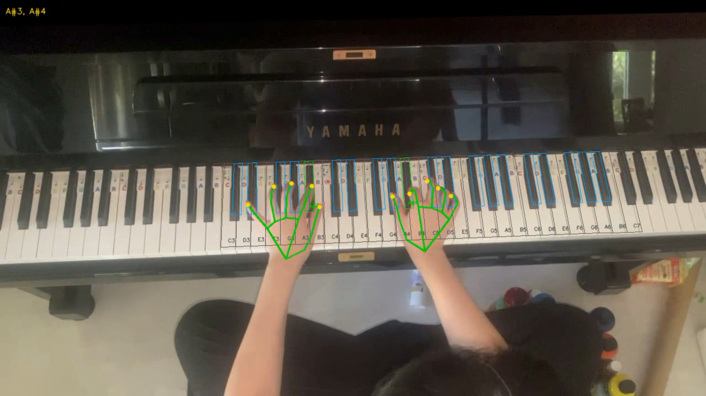
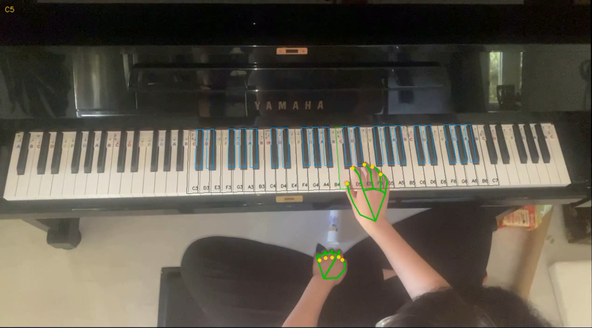

# Example screenshots

Selected annotated recording frames showing calibrated keys, hand landmarks, and detected note labels. These screenshots illustrate the output and are not accuracy measurements.

## F4 and F5

## A-sharp octaves

## C5

